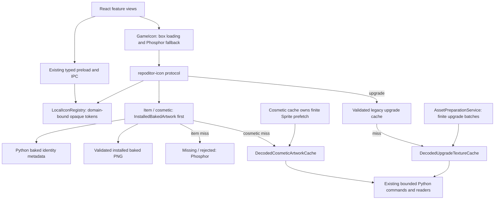
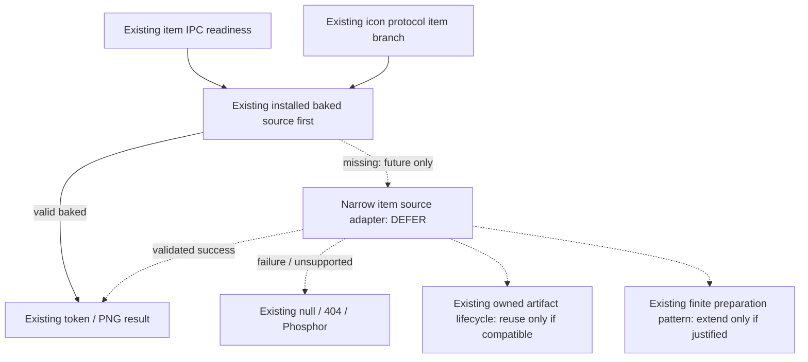

# Unity-native thumbnail rendering

Unity can execute shading that the offline Python experiment approximates, but
faithful thumbnail reproduction also requires recoverable shaders, exact capture
state and a compatible rendering environment. The inspected mod techniques use
generic cameras or lights, and AssetRipper's public export path does not establish
recovery of custom compiled shaders. A matching native control render has not been
performed.

See the [geometry and full-color analysis](missing-item-thumbnail-proof.md) for
per-item coverage, source capture settings and RGBA comparison metrics.

## Source references

The analysis uses these source revisions:

| Repository                                                                                              | Inspected commit                           | Code license                                                                                                   |
| ------------------------------------------------------------------------------------------------------- | ------------------------------------------ | -------------------------------------------------------------------------------------------------------------- |
| [ScalerCore](https://github.com/VirtualPixel/ScalerCore/tree/e0ba37541cc5077bfb9213b977e490cbc32dd73f)  | `e0ba37541cc5077bfb9213b977e490cbc32dd73f` | [MIT](https://github.com/VirtualPixel/ScalerCore/blob/e0ba37541cc5077bfb9213b977e490cbc32dd73f/LICENSE)        |
| [MoreHeadBridge](https://github.com/xuaun/MoreHeadBridge/tree/a2c41b880dc1a3c1192a44c027e51c3609ccfa62) | `a2c41b880dc1a3c1192a44c027e51c3609ccfa62` | [MIT](https://github.com/xuaun/MoreHeadBridge/blob/a2c41b880dc1a3c1192a44c027e51c3609ccfa62/LICENSE)           |
| [AssetRipper](https://github.com/AssetRipper/AssetRipper/tree/d8363d7aebd7132a7f531bb60ae201a2f167d815) | `d8363d7aebd7132a7f531bb60ae201a2f167d815` | [GPL-3.0](https://github.com/AssetRipper/AssetRipper/blob/d8363d7aebd7132a7f531bb60ae201a2f167d815/LICENSE.md) |

### ScalerCore

[`PocketHelper.cs`](https://github.com/VirtualPixel/ScalerCore/blob/e0ba37541cc5077bfb9213b977e490cbc32dd73f/Handlers/PocketHelper.cs#L18)
adds an equippable component to a live item, creates a maker when absent, and calls
the game's `ItemAttributes.GenerateIcon`. It excludes upgrades, Power Crystal and
health packs. Its generated rig uses renderer bounds, an invented three-quarter
direction, distance 2.5 and size-dependent FOV clamped to 27–80 degrees. It creates
a transparent 512×512 ARGB32 target with 32-bit depth and mask 9502721. This is a
source pattern for invoking Unity and game capture logic, not evidence
that its framing reproduces an authored baked icon.

The [detached vehicle handling](https://github.com/VirtualPixel/ScalerCore/blob/e0ba37541cc5077bfb9213b977e490cbc32dd73f/Handlers/PocketHelper.cs#L103)
adds `ItemVehicle.meshTransform` to bounds when outside the root hierarchy,
specifically mentioning the regular Semiscooter. This helper does not reparent or
otherwise establish how all detached geometry participates in capture relocation.
It also creates the maker inactive before assigning references, avoiding premature
`OnEnable` and a failed capture that could strand the live item off-world.

Its [project references](https://github.com/VirtualPixel/ScalerCore/blob/e0ba37541cc5077bfb9213b977e490cbc32dd73f/ScalerCore.csproj)
and [plugin](https://github.com/VirtualPixel/ScalerCore/blob/e0ba37541cc5077bfb9213b977e490cbc32dd73f/Plugin.cs)
depend on BepInEx, Harmony and game assemblies. Unity 2022 compile-time references
do not certify offline compatibility with this installed Unity 6 build. Default
build output targets a mod profile; building it can write into that profile.

### MoreHeadBridge

[`IsolatedIconRenderer.cs`](https://github.com/xuaun/MoreHeadBridge/blob/a2c41b880dc1a3c1192a44c027e51c3609ccfa62/MoreHeadBridge/Icons/IsolatedIconRenderer.cs#L15)
accepts a cosmetic asset. It instantiates its prefab at `(0,100000,0)`, disables
behaviours afterward, frames bounds with a generic 26-degree camera and chosen
three-quarter direction, then uses two white directional lights at intensities
1.2 and 0.55. It renders a 256×256 ARGB32 target, depth 16, AA 2, and reads RGBA32.
The caller owns the returned texture; `finally` restores the active target and
releases temporary objects. This proves the temporary camera/light/RenderTexture
technique inside an existing Unity runtime, not exact item-thumbnail reproduction.

Isolation is limited: instantiation precedes behaviour disabling, and the camera
uses all layers. Moving directional lights far away does not isolate their effect;
the source itself records that their position is irrelevant. No independent
process, dedicated scene or exclusively isolated lighting is established here.

[`IconCapture.cs`](https://github.com/xuaun/MoreHeadBridge/blob/a2c41b880dc1a3c1192a44c027e51c3609ccfa62/MoreHeadBridge/Icons/IconCapture.cs#L195)
selects this path for configured `.hhh` cosmetics, bilinearly reduces the result to
128×128 and writes a persistent game cache. That differs from our installed
512×512 control. Its cache location and empirical avatar-crop paths do not supply an offline,
source-derived item capture recipe. The [project](https://github.com/xuaun/MoreHeadBridge/blob/a2c41b880dc1a3c1192a44c027e51c3609ccfa62/MoreHeadBridge/MoreHeadBridge.csproj)
requires game, BepInEx, Harmony and REPOLib references; it is not a standalone
offline rendering tool.

### AssetRipper

The pinned [README](https://github.com/AssetRipper/AssetRipper/blob/d8363d7aebd7132a7f531bb60ae201a2f167d815/README.md#L15)
claims Unity 3.5.0 through 6000.4.X support, with varying support quality. This
includes our version range, but is not a successful export/import result.

The [prefab processor](https://github.com/AssetRipper/AssetRipper/blob/d8363d7aebd7132a7f531bb60ae201a2f167d815/Source/AssetRipper.Processing/Prefabs/PrefabProcessor.cs#L14)
reconstructs hierarchies, generates missing prefab objects and can add missing
transforms. The [prefab collection](https://github.com/AssetRipper/AssetRipper/blob/d8363d7aebd7132a7f531bb60ae201a2f167d815/Source/AssetRipper.Export.UnityProjects/Project/PrefabExportCollection.cs#L13)
exports hierarchy members with prefab serialization/importer/GUID machinery.
Recovering an editable hierarchy is plausible; exact original authoring structure,
material linkage, texture import settings and runtime state still require checking.

Shader recovery is the main fidelity risk. [Export settings](https://github.com/AssetRipper/AssetRipper/blob/d8363d7aebd7132a7f531bb60ae201a2f167d815/Source/AssetRipper.Export/Configuration/ExportSettings.cs#L40)
default to dummy shaders. The audited [exporter registration](https://github.com/AssetRipper/AssetRipper/blob/d8363d7aebd7132a7f531bb60ae201a2f167d815/Source/AssetRipper.Export.UnityProjects/ProjectExporter.Overrides.cs#L142)
selects YAML or dummy export, plus the simple-source exporter. A `Decompile` enum
value alone does not establish functioning decompilation in this path.
[`SimpleShaderExporter`](https://github.com/AssetRipper/AssetRipper/blob/d8363d7aebd7132a7f531bb60ae201a2f167d815/Source/AssetRipper.Export.UnityProjects/Shaders/SimpleShaderExporter.cs#L12)
only accepts existing nonempty script text without `Program`/`SubProgram` markers.
[`DummyShaderTextExporter`](https://github.com/AssetRipper/AssetRipper/blob/d8363d7aebd7132a7f531bb60ae201a2f167d815/Source/AssetRipper.Export.UnityProjects/Shaders/DummyShaderTextExporter.cs#L50)
preserves properties but supplies template/fallback shading. The
[YAML exporter](https://github.com/AssetRipper/AssetRipper/blob/d8363d7aebd7132a7f531bb60ae201a2f167d815/Source/AssetRipper.Export.UnityProjects/Shaders/YamlShaderExporter.cs)
explicitly warns that `Shader.Find` will not work in the Editor with its output.
A material with the right shader name is insufficient evidence of original code.
Paid editions and other exporters were not evaluated.

The final exporter overrides also install engine-resource mapping. The matching
Editor's built-in Standard shader could therefore support the Health Pack control
without recovering custom shader source; this is a plausible route, not a tested
export result. It would not establish recovery of Leaf Blower's custom shader.

Scripts default to Hybrid export. The [script-mode definitions](https://github.com/AssetRipper/AssetRipper/blob/d8363d7aebd7132a7f531bb60ae201a2f167d815/Source/AssetRipper.Export/Configuration/ScriptExportMode.cs)
describe decompiling game assemblies and warn about compilation errors. A future
harness would also need to prevent recovered gameplay/editor initialization from
running, including `Awake` before components can be disabled. Removing those
components can lose visual state, so successful static rendering would still need
to be distinguished from authentic game capture. A static render with stripped components cannot establish the lost runtime state.

The audited [project export](https://github.com/AssetRipper/AssetRipper/blob/d8363d7aebd7132a7f531bb60ae201a2f167d815/Source/AssetRipper.Export.UnityProjects/ProjectExporter.cs#L75)
iterates the loaded bundle's assets, rather than accepting one selected prefab's
dependency closure. [Post-export](https://github.com/AssetRipper/AssetRipper/blob/d8363d7aebd7132a7f531bb60ae201a2f167d815/Source/AssetRipper.Export.UnityProjects/ExportHandler.cs#L131)
includes project version, packages, StreamingAssets and assemblies.
[StreamingAssets copying](https://github.com/AssetRipper/AssetRipper/blob/d8363d7aebd7132a7f531bb60ae201a2f167d815/Source/AssetRipper.Export.UnityProjects/Project/StreamingAssetsPostExporter.cs#L20)
is recursive unless configured to ignore it; the
[DLL exporter](https://github.com/AssetRipper/AssetRipper/blob/d8363d7aebd7132a7f531bb60ae201a2f167d815/Source/AssetRipper.Export.UnityProjects/Scripts/DllPostExporter.cs#L11)
saves loaded assemblies. Therefore the default whole-installation route would
exceed our one-item scope. A future proof needs a dependency-closed subset and
disabled broad copying; the audited default path does not provide that bounded selection.

## Toolchain requirements

| Assessed environment                                               | Observed result                                                                                                                                                                           |
| ------------------------------------------------------------------ | ----------------------------------------------------------------------------------------------------------------------------------------------------------------------------------------- |
| `Unity`, `UnityHub`, `AssetRipper`, `AssetRipper.GUI.Free` on PATH | None found                                                                                                                                                                                |
| Registry Unity entry                                               | 2022.3.62f1 points to `E:\Unity Engine\2022.3.62f1\Editor\Unity.exe`; executable and containing engine directory are absent                                                               |
| Matching Unity Editor                                              | 6000.3.17f1 not found in checked locations                                                                                                                                                |
| AssetRipper                                                        | No executable or portable archive found in checked locations                                                                                                                              |
| .NET                                                               | Host exists; `dotnet --list-sdks` is empty; installed runtimes are 6.0.16, 8.0.13 and 8.0.21                                                                                              |
| Pinned AssetRipper source                                          | Targets [`net10.0`](https://github.com/AssetRipper/AssetRipper/blob/d8363d7aebd7132a7f531bb60ae201a2f167d815/Source/Directory.Build.props#L3); cannot build with this installed toolchain |
| Existing Python research tools                                     | Prior probes and locked UnityPy environment remain available; no native Editor runtime                                                                                                    |

Checks covered PATH, uninstall registration, the registered Editor path, standard
Unity/Hub/AssetRipper roots, common portable-tool/download locations and Hub
configuration locations. This was a bounded inventory, not a full-disk search;
an executable in an unknown private directory remains possible. Editor entitlement
and graphics-device execution are unverified. A self-contained AssetRipper release could
avoid a .NET runtime install, but no native export/render result is available.

The game assets identify 6000.3.17f1. Start any later proof with that exact
Editor and original graphics path, rather than downgrading to 2022. Unity documents
incompatible asset downgrading as unsupported/high risk. Batch mode can automate
an Editor method, but `-nographics` disables graphics-device initialization; it is
not a solution for this RenderTexture proof.
([Unity command-line reference](https://docs.unity.com/en-us/engine/6000.3/manual/unity-editor/command-line-arguments/editor))

The earlier built-in Resources header 6000.3.11f1 remains a real mixed-version
input. AssetRipper registers engine-resource mapping against its export version,
but that does not verify these particular mesh references. The production artwork reader rejects that built-in resource version. Leaf Blower's inherited camera scale 0.9 is a useful future
engine-conformance case, but it was not converted into an arbitrary camera fit.

## Control requirements

The native control is `Item Health Pack Small`: complete inspected geometry,
authored unscaled camera, recoverable textures and a Standard material. Use the
[source findings and exact baked identity](missing-item-thumbnail-proof.md#exact-control-and-source-findings)
and compare original 512×512 RGBA without resizing, registration or reference-driven
camera/light adjustments. Measure foreground RGB, alpha, complete RGBA and black/
white composition; a high silhouette IoU alone is insufficient.

No Unity-native control, export/import check, shader compilation test or missing-item
render was run. A compatible toolchain was unavailable in the assessed locations.
Shader/material/transform survival through export is therefore untested. The
[Python RGBA measurements](missing-item-thumbnail-proof.md#rgba-comparison) are not
Unity-native results.

Leaf Blower's `Semiwork/Alpha Clip` shader must survive export authentically before
its authored scaled camera can be tested. The other missing prefabs additionally
need authored framing or dynamic/procedural geometry. Unity does not infer missing
camera choices or reproduce gameplay initialization from a prefab export alone.

## Complexity, licensing and product fit

| Approach                         | What it offers                                                                  | Complexity and deployment consequence                                                                                                                                   | Decision                                                             |
| -------------------------------- | ------------------------------------------------------------------------------- | ----------------------------------------------------------------------------------------------------------------------------------------------------------------------- | -------------------------------------------------------------------- |
| AssetRipper + matching Editor    | Executes real Unity shading if original shaders, resources and settings survive | Export/import, shader recovery, Editor entitlement, GPU/device setup and dependency isolation; no native timing/memory measurements                                     | Requires matching tools, bounded subset export and authentic shaders |
| The two mods' runtime techniques | Native cameras and RenderTextures in an initialized game                        | Depend on the running modded game; generic framing/lights do not establish baked fidelity                                                                               | Reference patterns only; reject runtime integration                  |
| Current Python proof             | Bounded, read-only, deterministic control experiment using existing readers     | About 0.346 s render computation / 26.247 s total for the prior control; 31.33 MiB counted primary buffers, not peak RSS; adding Unity systems would grow scope sharply | Bounded control only; full renderer scope is disproportionate        |

Native rendering could avoid implementing GPU shading ourselves. It does not
eliminate export, import, resource recovery, capture-state or licensing work. No
native startup, import, disk, CPU, peak memory, GPU memory or installer benchmark
exists; a fast `Camera.Render` call in an already running game measures none of
those costs. Existing eight-file/768-MiB input, 64-MiB stream, 16-MiB object,
512-object hierarchy, 512px output and 120-second research-process bounds remain
unchanged. They are not silently relaxed for an unmeasured Editor/export pipeline.

An Editor-based product path would require users to obtain a compatible Editor and
license. A separately built Unity Player could theoretically avoid a per-user
Editor, but would introduce a rendering runtime, asset-loading format, packaging,
compatibility and license obligations. Referencing game `UnityEngine` DLLs alone
does not supply the native engine environment that these mods assume. Neither runtime was built or sized for RepoDitor. Launching/modifying the game, installing
BepInEx and bundling extracted assets are excluded. Generating the seven PNGs once
and shipping them would still redistribute game artwork.
This research also supplies no browser rendering path for the hosted Web product.

RepoDitor and the two mods are MIT; AssetRipper is GPL-3.0. Code/library redistribution requires a license assessment; a
GPL tool's license neither grants rights to R.E.P.O. assets nor automatically
establishes the license of every exported file. Unity Editor/runtime distribution
has separate [Unity Software Terms](https://unity.com/legal/editor-terms-of-service/software).
Research extraction is not permission to bundle proprietary shaders or artwork.
Tool licenses do not establish rights to the extracted game content.

## Integration boundaries

Items, cosmetics and upgrades share presentation and opaque transport while
retaining source-specific caches. The existing source flow is:

The [architecture guide](../architecture/architecture.md#desktop-local-presentation-assets)
defines cache ownership, lifecycle and source order; the
[installed artwork analysis](truck_artwork.md) explains
the evidence-pinned reader boundary. `ipc/items.cts` currently requires
`availableItems` baked readiness before issuing a regular-item token. A missing
item normally receives null before any image-protocol request.

The decoded caches share watch parsing, memory and
in-flight maps, serialized persistence, manifests and temporary-file cleanup. These
are candidates for reuse only where contracts actually coincide. Their keys,
payload validation, content hashing/deduplication, versions, pruning and batch
ownership differ. The baked manifest validates a different artifact altogether.
Those differences do not justify a forced merger or a new artwork manager for
seven items.

A possible item source adapter would extend existing readiness and byte resolution,
preserving baked priority and provenance. Editing `serveVisual` alone cannot reach
null-token items. The diagram describes that unimplemented integration seam:

A generated artifact must remain distinguishable from genuine baked output. Its invalidation
would include source files, capture recipe, shader/export version, Unity version
and relevant graphics settings. The baked validation-stamp manifest cannot simply
hold it. Likewise item names must not be squeezed into cosmetic IDs or upgrade
keys. If compatible existing persistence cannot accommodate the proven source
without disproportionate changes, retain placeholders instead of creating a
parallel cache subsystem.

| Abstraction or boundary                                                                | Classification | Action                                                                                      |
| -------------------------------------------------------------------------------------- | -------------- | ------------------------------------------------------------------------------------------- |
| Baked metadata index and installed-PNG validation manifest                             | KEEP           | Distinct provenance and invalidation responsibilities                                       |
| Separate cosmetic Sprite and upgrade caches/parsers                                    | KEEP           | Different correctness contracts; preserve versions, namespaces and lifecycle                |
| Legacy upgrade-only cache path, mutation gates, Desktop/Web separation                 | KEEP           | No regular-item LocalLow access or capability changes                                       |
| Opaque icon registry/protocol, typed preload/IPC and GameIcon                          | REUSE          | No second URL scheme, raw paths, renderer engine logic or presentation layer                |
| Existing source validation, PNG checks and bounded asset readers                       | REUSE          | Generated output must satisfy equally strict validation and ownership                       |
| Existing item readiness and protocol source selection                                  | EXTEND         | Requires demonstrated fidelity; preserve baked priority                                     |
| Existing finite scheduling and compatible owned artifact persistence                   | EXTEND         | Conditional, contract-reviewed extension; no automatic reuse of incompatible keys/manifests |
| A narrow reconstructed-item source adapter                                             | DEFER          | Native fidelity and deployment remain unproven                                              |
| Disposable Unity control harness and bounded export selection                          | DEFER          | Requires matching tools, shader recovery and strict limits                                  |
| Unity Editor or Player as a production rendering backend                               | DEFER          | Unproven shader recovery, deployment cost and runtime redistribution rights                 |
| Shared cache-storage extraction                                                        | DEFER          | Do not refactor working caches on hypothetical future needs                                 |
| Independent artwork manager, resolver, IPC protocol or item-cache subsystem            | REJECT         | Duplicates established ownership for seven unresolved images                                |
| Permanent renderer worker or full custom Unity renderer                                | REJECT         | Disproportionate subsystem and maintenance cost                                             |
| Forced cache/parser merger or domain-key coercion                                      | REJECT         | Weakens distinct validation/invalidation contracts                                          |
| Runtime injection, game patching, bundled game assets or silent Editor/runtime install | REJECT         | Incompatible with read-only discovery and asset redistribution boundaries                   |

## Reproducing a native control

1. Verify the matching Editor version, graphics support and entitlement. `Unity.exe
-version`, `dotnet --list-sdks` and `dotnet --list-runtimes` identify installed
   tooling. The assessed AssetRipper source targets .NET 10; the available .NET 6/8
   runtimes and empty SDK list cannot build it.
2. Identify the control prefab's dependency closure. Export only required geometry,
   textures, materials and capture resources into an ignored disposable project;
   suppress recursive StreamingAssets and assembly copying.
3. Check recovered references, transforms, texture import/sampling settings and
   executable shaders. Dummy shader templates do not pass this check.
4. Render the documented Health Pack camera/light recipe with the matching Unity
   graphics path. Prevent recovered gameplay/editor initialization from touching
   game files, saves or LocalLow. Do not fit parameters to the reference image.
5. Compare the exact RGBA buffers and inspect visible residuals before attempting
   Leaf Blower. Stop if essential resources cannot be recovered without a large
   new extraction or rendering subsystem.

Native cold/warm startup, import cost, memory, GPU memory, relaunch, invalidation,
cancellation and process-tree cleanup remain unmeasured. Python research bounds
do not establish equivalent guarantees for an Editor/export pipeline. No native
renderer, cache or permanent worker is part of RepoDitor's supported artwork path.
